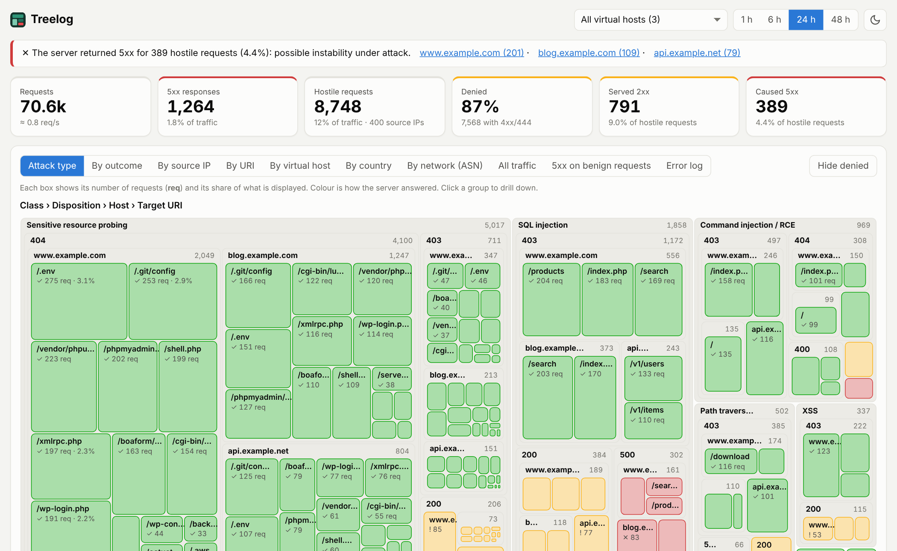
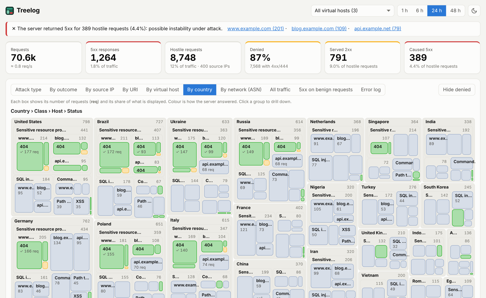

<p align="center"></p>

# Treelog

Treelog is a lightweight analyzer for nginx and Apache logs that shows how your server responds to hostile traffic: what was requested, from where, and whether each request was blocked, served, or caused a server error.

It runs as a single container, uses only the Python standard library, and needs no database or external service.



<sub>Dark theme: [docs/screenshot-dark.png](docs/screenshot-dark.png).</sub>

## Features

- Interactive treemap with drill-down by attack type, outcome, target URI, source IP, virtual host, country and network. With several virtual hosts, each drill-down also splits by host, so you can see where a request landed.
- Every hostile request is classified by how the server answered: denied (4xx/444), served (2xx), redirected (3xx) or server error (5xx).
- Reads nginx and Apache access and error logs, across multiple files and virtual hosts.
- Alerts to ntfy, Telegram and webhooks.
- Detects offending IPs from their behaviour and exports a blocklist for nginx, Apache or iptables.
- Optional country and ASN lookups through IPinfo.
- Small footprint: about 20 MB of RAM (as reported by `docker stats`), with memory bounded whatever the traffic.
- Hardened by default: read-only log mount, non-root container with a read-only filesystem, strict Content Security Policy, optional basic authentication.

## Installation

Requires Docker with Docker Compose and web server logs written to files on the host.

```bash
git clone https://github.com/giuseppebruno/treelog.git
cd treelog
cp .env.example .env
```

Edit `.env` and set at least:

| Variable | Example | Description |
|---|---|---|
| `LOG_DIR` | `/var/log/nginx` | Log directory on the host (Apache: `/var/log/apache2`). |
| `LOG_GID` | `4` | Group allowed to read the logs: `stat -c %g /var/log/nginx/access.log`. |
| `TZ` | `Europe/Rome` | Timezone of the web server host (error log timestamps carry no UTC offset). |

Then start it:

```bash
docker compose up -d --build
```

The dashboard is available at <http://localhost:8080> (or the `PORT` you set). To upgrade: `git pull && docker compose up -d --build`.

> nginx in Docker: write `access_log` and `error_log` to files (the official image logs to stdout) and mount that directory.

## Configuration

Everything is configured through environment variables in `.env`. [`.env.example`](.env.example) lists the common ones with their defaults and a short explanation; the complete reference, including the advanced settings (memory limits, timing, detection thresholds), is in [docs/configuration.md](docs/configuration.md).

Supported formats: nginx `combined` and Apache `combined` / `vhost_combined` access logs, nginx and Apache (2.2 and 2.4) error logs. For other formats set `ACCESS_REGEX` with named groups `ip`, `ts`, `req`, `status`, `ua` and, optionally, `vhost`.

Main settings:

| Variable | Default | Description |
|---|---|---|
| `ACCESS_LOGS`, `ERROR_LOGS` | `/logs/**/*access*.log*`, `/logs/**/*error*.log*` | Comma-separated globs for the log files. |
| `RETENTION_HOURS` | `48` | History length. |
| `IGNORE_IPS`, `IGNORE_REGEX` | empty | Exclude source addresses or request lines (monitors, false positives). |
| `DASH_USER`, `DASH_PASS` | empty | Basic authentication credentials. |

## Notifications

Notifications supports ntfy, Telegram or a generic webhook, alone or together.

| Channel | Variables |
|---|---|
| ntfy | `ALERT_NTFY_URL`, `ALERT_NTFY_TOKEN` (optional) |
| Telegram | `ALERT_TELEGRAM_TOKEN`, `ALERT_TELEGRAM_CHAT_ID` |
| Webhook | `ALERT_WEBHOOK_URL`, `ALERT_WEBHOOK_SECRET` (optional, signs the body with HMAC-SHA256 in `X-Treelog-Signature`) |

Rules, evaluated over the last 10 minutes: `server_errors`, `exposed`, `error_rate` and `spike` are enabled by default; `silence` and `offenders` can be added with `ALERT_RULES`. Thresholds and cooldown are described in `.env.example`.

## Offending IPs

Besides signatures, Treelog watches the behaviour of each source address over 10 minutes: enumeration (many distinct 4xx paths), credential brute force, request floods and repeated attacks. The panel exports the list as plain IPs, nginx `deny` lines, Apache `Require not ip` lines or `iptables` commands.

Treelog never blocks anything on its own: review the list before applying it. Behind a proxy or CDN, configure `real_ip` (nginx) or `mod_remoteip` (Apache) first.

## IP geolocation

Adds country and ASN views and the origin of offending IPs. It needs an IPinfo token and is off without one.



| Variable | Default | Description |
|---|---|---|
| `IPINFO_TOKEN` | empty | IPinfo access token. |
| `GEO_PROVIDER` | `auto` | `api`: query the IPinfo API (source IPs are sent to IPinfo). `mmdb`: download and refresh a local database, lookups stay local. `off`: disabled. `auto`: `api` if a token is set, else `off`. |

## Security

- The dashboard listens on `127.0.0.1` only. For remote access use a TLS reverse proxy with `DASH_USER` and `DASH_PASS`, or an SSH tunnel.
- The container runs as an unprivileged user with a read-only root filesystem, `cap_drop: ALL` and resource limits. Logs are mounted read-only.
- Log content is treated as untrusted input: it is always rendered as text and the CSP forbids inline scripts and styles.

## Known limitations

- It is not a WAF: it observes and notifies but does not block. Rules are heuristic and can yield false positives and false negatives.
- A 2xx response to a hostile request does not by itself indicate compromise (single-page apps with catch-all routes, `/wp-login.php` on WordPress). Use `IGNORE_REGEX` and `IGNORE_IPS` to exclude them.
- `POST` bodies do not appear in access logs and cannot be analyzed.

## Troubleshooting

| Symptom | Likely cause and fix |
|---|---|
| "no log files found" in `docker compose logs treelog` | Wrong `LOG_DIR`, or globs that do not match the file names. |
| Logs present but not read | The group owning the logs does not match `LOG_GID`. |
| "could not be parsed" warning in the logs | Non-standard format: set `ACCESS_REGEX`. |
| Error log timestamps are shifted | Set `TZ` to the timezone of the host writing the logs. |
| All requests come from the same IP | The server is behind a proxy: configure `real_ip` or `mod_remoteip`. |
| Geolocation not working | See `docker compose logs treelog`: usually a rejected token or no outbound access. |

## Development

Run without Docker (Python 3 only):

```bash
cd app
ACCESS_LOGS='/path/to/logs/**/*access*.log*' \
ERROR_LOGS='/path/to/logs/**/*error*.log*' \
STATE_FILE=/tmp/state.json PORT=8080 python3 main.py
```

## License

Treelog is released under the [MIT License](LICENSE).
